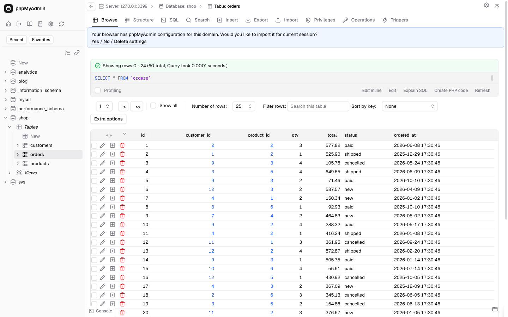
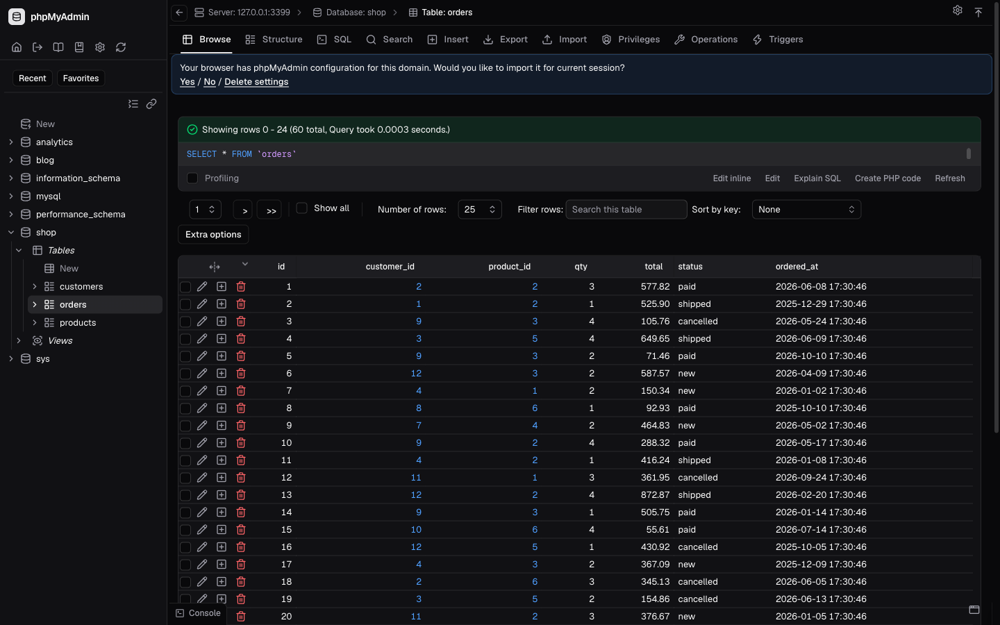

# Finally Modern

A [shadcn/ui](https://ui.shadcn.com)-inspired theme for **phpMyAdmin 5.2.x** (tested on 5.2.3), in light, dark and auto variants.




| Theme folder          | Look                                 |
| --------------------- | ------------------------------------ |
| `finally-modern`      | Light                                |
| `finally-modern-dark` | Dark                                 |
| `finally-modern-auto` | Follows the OS light/dark preference |

## Features

- **shadcn look:** zinc neutrals, thin borders, rounded corners, [Geist](https://vercel.com/font) and Geist Mono. Fonts are bundled, so there are no external requests.
- **Dense layout:** 13px text, about 26px table rows, 28px controls, no zebra stripes.
- **Lucide icons:** every phpMyAdmin icon, including the images it loads by file name, is drawn with [Lucide](https://lucide.dev). Icons follow the text colour. Delete is red, warnings amber, success green.
- **Icon-only table actions:** Edit, Copy, Delete, Change, Drop, index and user-account actions show only the icon. The label stays as the tooltip and the accessible name. The top tabs also collapse to icons below 1280px wide.
- **Restyled widgets:** jQuery UI dialogs and datepicker, tooltips, CodeMirror, the SQL console, the sidebar tree and the login page.

## Install

1. Download a zip from the [latest release](https://github.com/OmegaSkiller/pma-finally-modern/releases/latest).
2. Unzip it into your phpMyAdmin `themes/` directory, so you get e.g. `themes/finally-modern-dark/theme.json`:

   ```bash
   unzip finally-modern-dark-*.zip -d /path/to/phpMyAdmin/themes/
   ```

3. Pick the theme on phpMyAdmin's home page, or make it the default in `config.inc.php`:

   ```php
   $cfg['ThemeDefault'] = 'finally-modern-dark';
   ```

## Browser support

Chrome 111+, Safari 16.4+, Firefox 121+ (the CSS uses `oklch()`, `color-mix()` and `:has()`).

## Build from source

Requires Node 20+.

```bash
npm install
npm run build      # writes dist/<theme>/
npm run release    # also writes release/<theme>-<version>.zip
```

See [CONTRIBUTING.md](CONTRIBUTING.md) for how the build works and how to preview changes in a local phpMyAdmin.

## Credits and licences

- Theme: GPL-2.0-or-later, see [LICENSE](LICENSE)
- Layout partials: derived from phpMyAdmin's `bootstrap` theme (GPL-2.0-or-later)
- Icons: Lucide (ISC), see `static/LICENSE-lucide.txt`
- Fonts: Geist (SIL OFL 1.1), see `static/fonts/OFL-Geist.txt`
- Base framework: Bootstrap 5.3 (MIT)
