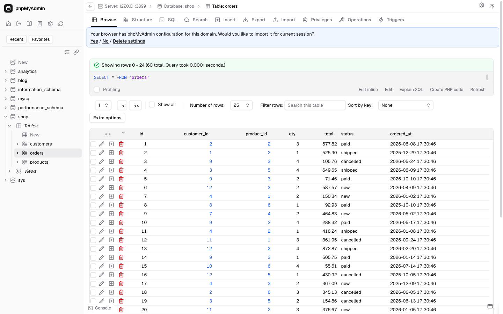
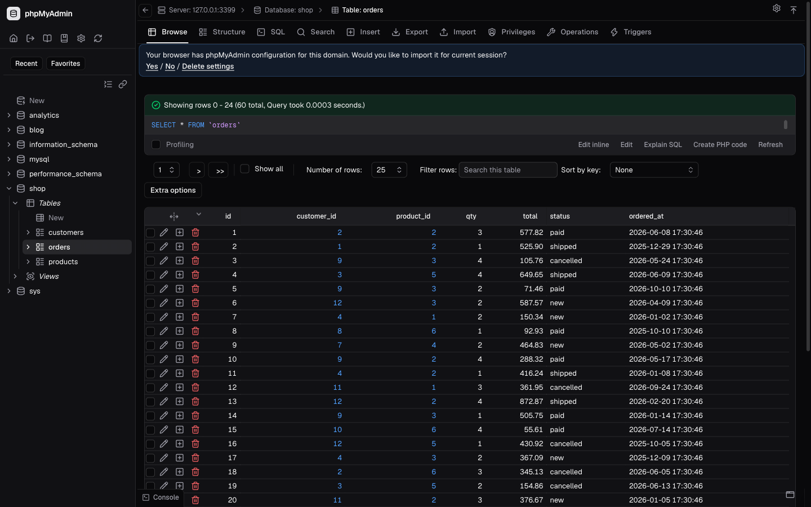

# Finally Modern — phpMyAdmin 5.2 theme

A shadcn-inspired theme for phpMyAdmin 5.2.x (tested on 5.2.3), in three variants:

| Theme folder            | Look                                      |
| ----------------------- | ----------------------------------------- |
| `finally-modern`        | Light                                     |
| `finally-modern-dark`   | Dark                                      |
| `finally-modern-auto`   | Follows the OS light/dark preference      |




## What's different

- **shadcn/ui look**: zinc neutrals, 1px borders, 6–12px radii, Geist + Geist Mono (bundled, no CDN).
- **Dense layout**: 13px base text, ~26px table rows, 28px controls, no zebra stripes.
- **Lucide icons everywhere**: each of phpMyAdmin's `ic_*` icons, plus the bitmaps it
  loads by file name, is drawn as a `currentColor` mask, so icons follow the text colour
  in both modes. Destructive, warning and success icons get semantic colours.
- **Icon-only actions** inside tables (Edit / Copy / Delete, Change / Drop / More, index
  actions, user-account actions…). The label stays as the image's `title`/`alt`, so you
  still get a tooltip and an accessible name.
- Top tabs collapse to icons below 1280px wide.
- Restyled jQuery UI dialogs, datepicker, tooltips, CodeMirror and the SQL console.

## Install

1. Download a zip from `release/` (or build it, see below).
2. Unzip into `phpMyAdmin/themes/` so you get e.g. `themes/finally-modern/theme.json`.
3. Pick the theme on phpMyAdmin's home page, or set it as default in `config.inc.php`:

   ```php
   $cfg['ThemeDefault'] = 'finally-modern-dark';
   ```

## Build

Requires Node 20+.

```bash
npm install
npm run build      # → dist/<theme>/
npm run release    # → dist/ + ../release/<theme>-<version>.zip
```

Pipeline (`build.mjs`):

1. **Sass** — Bootstrap 5.3 + phpMyAdmin's layout partials (`src/scss`). The partials were
   imported from phpMyAdmin's stock `bootstrap` theme by `scripts/import-base.mjs`, which
   rewrites every hard-coded colour to a CSS custom property.
2. **Tailwind v4** — the design layer (`src/tailwind/*.css`) uses `@apply` on phpMyAdmin's
   selectors; it is written unlayered so it wins over the Bootstrap base.
3. **Lucide** — `src/icons.mjs` maps each phpMyAdmin icon id to a Lucide glyph.
4. **Tokens** — `src/tailwind/tokens-{light,dark}.css` define the colours per variant.
5. Minified with lightningcss (targets: Chrome 111, Safari 16.4, Firefox 121), plus an
   RTL sheet via rtlcss.

To retheme, edit the tokens; everything else reads from them.

## Credits & licences

- Theme: GPL-2.0-or-later (same as phpMyAdmin)
- Layout partials and fallback bitmaps: phpMyAdmin (GPL-2.0-or-later)
- Icons: [Lucide](https://lucide.dev) (ISC)
- Fonts: [Geist](https://vercel.com/font) (SIL OFL 1.1), see `static/fonts/OFL-Geist.txt`
- Base: Bootstrap 5.3 (MIT)
